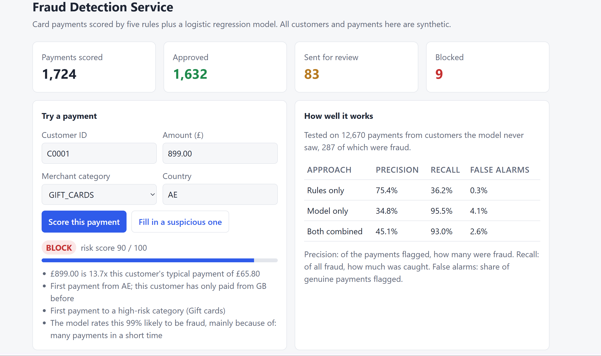

# Fraud Detection Service


A Java and Spring Boot service that looks at card payments as they come in and decides whether each one looks like fraud. It combines five readable rules with a small machine learning model I wrote from scratch, and every decision comes with plain-English reasons.



> **Note:** all the customers and payments here are synthetic. It's a learning project, not a real security control.

## Why I built it

Fraud detection is a good example of a problem where "is this suspicious?" depends entirely on who is paying. £900 on electronics is normal for some people and alarming for others. I wanted to build something that captures that idea properly, and to practise the tools banks and large software companies actually use: Java, Spring Boot, a SQL database, a REST API and automated tests.

I also wanted it to explain itself. A bank that blocks someone's card has to be able to say why, so a black-box score wasn't good enough.

## What it does

You send it a payment:

```json
{ "customerId": "C0035", "amount": 875.79, "merchantCategory": "GIFT_CARDS", "country": "IN" }
```

It looks up that customer's recent history, works out what's normal for them, scores the payment, saves it, and replies:

```json
{
  "riskScore": 95,
  "decision": "BLOCK",
  "reasons": [
    "£875.79 is 32.1x this customer's typical payment of £27.30",
    "First payment from IN; this customer has only paid from GB before",
    "First payment to a high-risk category (Gift cards)",
    "Payment at 02:54 UTC; this customer has never paid at night before",
    "The model rates this 99% likely to be fraud, mainly because of: unusual time of night"
  ]
}
```

That's a real result from the demo data, for a payment made at 02:54 at night. There's also a small dashboard at `http://localhost:8080` that shows recent flagged payments, lets you try your own, and shows how well the detector performs.

## How it works

```
 Payment arrives (POST /api/transactions)
        │
        ▼
 Load this customer's last 90 days of payments from the database
        │
        ▼
 Build a profile: typical spend, usual countries, usual shops,
 payments in the last 10 minutes, whether they ever pay at night
        │
        ├──────────────► 5 rules ──────────► rule score (0–100) + reasons
        │
        └──────────────► logistic regression ► fraud probability (0–1)
                                    │
        ┌───────────────────────────┘
        ▼
 Risk score = 50% rules + 50% model
   70 or more → BLOCK      40–69 → REVIEW      below 40 → APPROVE
        │
        ▼
 Save the payment with its score, decision and reasons
```

**The rules** each look for one kind of suspicious behaviour:

| Rule | What it looks for | Points |
|---|---|---|
| Unusual amount | 3x the customer's typical payment (8x scores higher) | 20 or 40 |
| New country | First ever payment from this country | 25 |
| Rapid fire | 5 or more payments within 10 minutes | 30 |
| High-risk merchant | First ever payment to gambling, crypto or gift cards | 15 |
| Late night | A payment between midnight and 5am from someone who never pays at night | 10 |

**The model** is a logistic regression with eight features (how much bigger than usual, new country, recent burst, and so on). I wrote it from scratch instead of using a library, so every step can be explained. It's trained when the app starts, on 1,000 synthetic customers.

**Why both?** Rules are predictable and easy to explain, but they only catch what someone thought to write a rule for, and each threshold is a hard cliff. The model weighs all the signals together and picks up combinations of small warning signs, but on its own it's harder to explain. The results below show the combination beats either one alone.

## Results

Tested on 12,670 payments from customers the model never saw during training, 287 of them fraud:

| Approach | Precision | Recall | False alarm rate | F1 |
|---|---|---|---|---|
| Rules only | 75.4% | 36.2% | 0.3% | 0.49 |
| Model only | 34.8% | 95.5% | 4.1% | 0.51 |
| **Both combined** | **45.1%** | **93.0%** | **2.6%** | **0.61** |

- **Precision:** of the payments it flagged, how many were really fraud.
- **Recall:** of all the fraud, how much it caught.
- **False alarm rate:** of all the genuine payments, how many it flagged by mistake.

In plain words: the combined detector catches about 93% of fraud, and bothers about 1 in 40 genuine payments. The rules alone almost never raise a false alarm, but miss nearly two thirds of the fraud. The model alone catches almost everything, but raises far more false alarms. Blending them keeps most of the model's recall while cutting its false alarms by a third.

By type of fraud, the combined detector caught:

| Fraud pattern | Caught |
|---|---|
| Account takeover (large payments, often abroad or at night) | 100% |
| Card testing (tiny test payments, then a big one) | 93% |
| Subtle spend (a bit more than usual, at home, in the day) | 75% |

The subtle pattern is hardest, as you'd expect: it's designed to look normal. Most of the missed card-testing payments are the first one or two tiny test payments, before a burst has built up.

These numbers come from `GET /api/model/evaluation` and are recalculated every time the app starts. They're good on synthetic data, which is a much easier world than real banking. I'd expect real-world performance to be noticeably lower.

## Things I was careful about

- **Splitting by customer, not by payment.** If I'd split payments randomly, the same customer would appear in both training and testing, and the model would look better than it is. I split customers, so the test answers the real question: how well does it work on someone new?
- **Never looking at the future.** Each payment is judged only on payments that came before it. Otherwise the history would leak information it couldn't have had at the time.
- **Not trusting accuracy.** Fraud is about 2% of payments, so a detector that never flags anything would be 98% "accurate". That's why I report precision, recall and the false alarm rate instead.
- **Rare fraud in training.** Fraud examples are given more weight during training, so the model can't do well by just ignoring them.
- **Realistic noise.** The synthetic data includes genuine behaviour that looks suspicious (holidays abroad, one-off big purchases, quick bursts of payments, night owls, regular gamblers), so the detector can't just learn "anything unusual is fraud".
- **Money as `BigDecimal`.** Never `double`, because doubles can't store values like 0.10 exactly.
- **Validated input.** Bad requests get a clear 400 error explaining what's wrong.

## Running it

You'll need **Java 21** and **VS Code** with Microsoft's **Extension Pack for Java**. Maven is optional: VS Code's Java extension can download the libraries and run the app itself.

1. Open the project folder in VS Code and wait for the Java extension to finish loading (watch the bottom bar).
2. Open `src/main/java/io/github/hamzahamidhar/fraud/FraudDetectionApplication.java` and click **Run** above `main`.
3. When the terminal says `Dashboard ready at http://localhost:8080`, open that address in your browser.

If you have Maven installed, you can use these commands instead:

```
mvn spring-boot:run      # start the app
mvn test                 # run all the tests
```

### Trying the API

From PowerShell on Windows:

```powershell
Invoke-RestMethod -Method Post -Uri http://localhost:8080/api/transactions `
  -ContentType "application/json" `
  -Body '{"customerId":"C0001","amount":899,"merchantCategory":"GIFT_CARDS","country":"AE"}'
```

Or from macOS, Linux, or Git Bash:

```bash
curl -X POST http://localhost:8080/api/transactions \
  -H "Content-Type: application/json" \
  -d '{"customerId":"C0001","amount":899,"merchantCategory":"GIFT_CARDS","country":"AE"}'
```

| Endpoint | What it does |
|---|---|
| `POST /api/transactions` | Score and save a new payment |
| `GET /api/transactions` | The 50 most recent payments (add `?decision=BLOCK` to filter) |
| `GET /api/transactions/flagged` | Recent payments marked REVIEW or BLOCK |
| `GET /api/transactions/{id}` | One payment |
| `GET /api/customers/{id}/transactions` | One customer's recent payments |
| `GET /api/stats` | How many payments were approved, reviewed and blocked |
| `GET /api/model/evaluation` | The test results above |

You can also browse the database at `http://localhost:8080/h2-console` (JDBC URL `jdbc:h2:mem:frauddb`, user `sa`, no password).

## Project structure

```
src/main/java/io/github/hamzahamidhar/fraud/
├── detection/        The core logic. Plain Java, no Spring, so it's easy to test.
│   ├── CustomerProfile.java    What's "normal" for a customer
│   ├── FraudDetector.java      Blends rules and model into a decision
│   ├── rules/                  The five rules
│   └── model/                  Feature extraction and the logistic regression
├── simulation/       Generates synthetic customers, payments and fraud
├── evaluation/       Trains the model and measures precision and recall
├── domain/           The database entity and shared enums
├── repository/       Database access (Spring Data JPA)
├── service/          What happens when a payment arrives
├── api/              REST controller, request/response types, error handling
└── config/           Wires everything together and loads demo data
```

The detection logic doesn't depend on Spring at all. The web and database layers are a thin shell around it, which is why most of it can be tested with fast, ordinary unit tests.

## Tests

There are 40 tests: unit tests for each rule (both when it should fire and when it should stay quiet), the profile, the model and the metrics, plus integration tests that send real HTTP requests through the whole app. One test also checks the detector's recall and false alarm rate, so a change that quietly makes it worse will fail the build. GitHub Actions runs them all on every push.

## Limitations

- **Synthetic data.** The fraud patterns are ones I designed, so the detector is partly being tested on rules I already knew about. Real fraud is messier and keeps changing.
- **Trained at startup.** A real system would train offline, version the model, and load it, rather than retraining every time it starts.
- **In-memory database.** Everything disappears when the app stops. Switching to PostgreSQL only needs a config change and a driver.
- **No authentication.** Anyone who can reach the API can use it.
- **Time zones.** "Night" means midnight to 5am UTC, not the customer's own local time.
- **No feedback loop.** In real life, analysts confirm or reject flagged payments, and those answers would be used to retrain the model.

## What I'd add next

- Log in with Spring Security, so only analysts can see flagged payments
- PostgreSQL and a Dockerfile, so it runs the same everywhere
- An endpoint for analysts to confirm or reject a flag, feeding back into training
- Comparing the model against a tree-based model, such as gradient boosting

## Built with

Java 21 · Spring Boot 3.5 · Spring Data JPA · H2 · JUnit 5 · MockMvc · GitHub Actions

## Licence

MIT. See [LICENSE](LICENSE).
